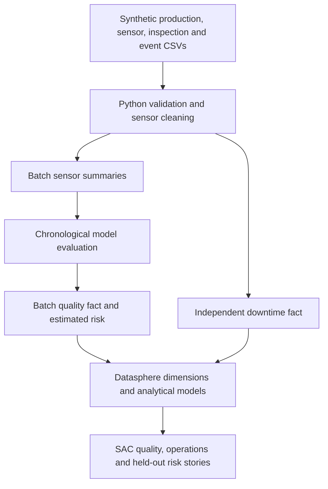

# Project guide and KPI contract

## Architecture

RAW = source CSVs; STAGING = cleaned readings and batch summaries inside Python; DIMENSION and FACT = SAP import CSVs; CONSUMPTION = SQL views and SAP analytic models. These are logical layers; separate tenant schemas are not assumed.

## KPI definitions
| KPI | Formula | Grain / interpretation |
|---|---|---|
| Production volume | SUM(PRODUCTION_VOLUME) | Vehicles produced; no vehicle defect label |
| Inspected batches | SUM(INSPECTED_BATCHES) | One inspection per batch in this demonstration |
| Failed batches | SUM(FAILED_BATCHES) | Batches failing initial inspection |
| Defect rate % | 100 × SUM(FAILED_BATCHES) / SUM(INSPECTED_BATCHES) | Batch failure rate; never average row percentages |
| First-pass yield % | 100 × SUM(FIRST_PASS_BATCHES) / SUM(INSPECTED_BATCHES) | Batch initial pass rate; complements failure rate here |
| Downtime minutes | SUM(DOWNTIME_MINUTES) | Separate event fact; events do not overlap on a machine |
| Estimated risk | RISK_SCORE | Inspect at batch grain; AVG only when explicitly labelled mean risk |

Use null for zero-denominator rates. Do not join raw sensor rows or downtime events directly to batches: row multiplication inflates totals. Link facts through shared dimensions or separate story models. Downtime is assigned to its start date; generated events do not cross midnight. Real overlapping events require interval union, and real cross-day events require day splitting.

## Model protocol
Features: mean valid temperature, humidity and pressure collected before batch completion. Inspection time, defect type, outcome, batch identifiers and post-inspection data are excluded from training. Missing/out-of-range readings become null; within-batch means ignore null values and the model imputes remaining missing summaries using training medians. No per-batch interpolation uses future readings.

Train first 60%, select threshold on next 20%, report metrics on final 20%. Test records are scored without refitting. Development scores are supplied for exploration but must be filtered out of performance claims. Baseline predicts training class prior. Class-weighted logistic output is not calibrated; calibration is future work. Inspect precision, recall, F1, average precision and confusion matrix together.

## Investigation walkthrough
1. Filter a line and shift in Quality Overview. Compare failed counts and inspected counts, not only percentages.
2. In Risk Investigation filter SCORE_SCOPE = HELD_OUT. Sort risk descending.
3. Select a batch. Compare temperature, humidity, pressure, risk flag and actual inspection status.
4. Explain false positives and missed failures using the held-out confusion matrix.
5. Open Operations. Compare downtime concentration by machine and event category. Do not claim downtime caused quality changes.

## Future extensions
Real source ingestion, repeated inspection history, vehicle-level labels, temporal drift checks, calibration, model registry, and scheduled ingestion/scoring.
